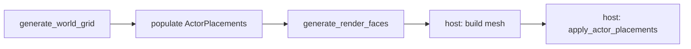

# Population

Technical reference for Unreal **GenerationPopulation**’s engine-agnostic placement math, ported as `margen_generation_population`.

Builds an abstract list of **`ActorPlacement`** records during world design. Hosts (**margen-godot**, Marloth) instantiate **actors** from that list only after mesh realization—no scene tree work during populate.

## Terminology

| Term | Meaning |
|------|---------|
| **Placeable** | What can be placed (`PlaceableId`; engine-agnostic). |
| **ActorPlacement** | Resolved placement (cell location(s) + placeable id) before spawn. |
| **Actor** | Realized spatial 3D object in the host (characters, props, triggers, spawn markers). Mesh geometry is not an actor. |
| **populate** | Build `ActorPlacements` from the abstract world. |
| **apply actor placements** | Host-only: instantiate actors from the list. |

**Deferred:** `PlaceableSlot`, `gather_grid_slots`, `PopulationCategory`, distributors / `category_distribution`, `ActorSpawner`, floor alignment.

## Pipeline

Abstract (margen): grid → populate → faces. Realize (host): mesh, then actors.

Wired through `margen_generate_world_faces` in `margen_ffi`. Export: `margen_world_faces_placements_bulk`.

## First pass

Only **player spawn** (`PLACEABLE_PLAYER_SPAWN` / `MARGEN_PLACEABLE_PLAYER_SPAWN`) at grid `player_start` (origin / first cell). Bypasses slot gather and category distribution.

### Intentional vs Unreal

Unreal’s `placePlayerStart` was a hardcoded post-populate spawn outside `ActorPlacements`. Here the player spawn is a normal `ActorPlacement` so gather and apply stay one pipeline (pipeline cleanup; not an improvement-class outcome change for gameplay).

## API sketch

| Symbol | Role |
|--------|------|
| `PlaceableId`, `PLACEABLE_PLAYER_SPAWN` | Placeable identity |
| `ActorPlacement`, `ActorPlacements` | Placement dataset |
| `populate_player_start` / `append_player_start_placement` | Player-spawn placement |
| `populate_world` | Top-level populate (player spawn only for now) |

Unreal reference: `GenerationPopulation/` (slots, placeables, distribution); orchestration in `SimulationGeneration/Population/PopulateWorld.cpp`.
