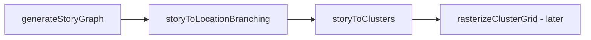

# Story graph (progression pipeline)

Technical reference for the **story graph** path in world generation: an abstract progression DAG that is laid out in space before richer narrative content attaches. For player-facing intent, see Marloth [`docs/game/features/gameplay/story-progression.md`](../../marloth/docs/game/features/gameplay/story-progression.md) (sibling workspace folder **`marloth`**).

## Pipeline

| Stage | Role |
|-------|------|
| `generateStoryGraph` | Builds a linear chain of nodes with `direct` (first link) and `unlocks` (later links) connection attributes. |
| `storyToLocationBranching` | Rewires the chain into a branching DAG so keys are not adjacent to gates; forces backtracking in traversal order. |
| `storyToClusters` | Places one grid cell per node and connects paths between spatial neighbors (or records portal pairs when space is exhausted). |
| `rasterizeClusterGrid` | Expands sparse cluster cells into room-sized hex footprints (**not yet ported**). |

Public composition API in margen: `generateStoryGrid` (`margen/Structure/Story/GenerateStoryGrid.h`).

## Connection attributes

Defined in `margen/Story/Types.h` (`StoryConnectionAttribute`):

- **`direct`** — nodes are spatial neighbors with no gating between them.
- **`unlocks`** — the source node holds the means to open progress toward the target (switch/key semantics downstream).

## Unreal reference behavior

In **unreal-marloth**, the story path is selected when `GENERATE_STORY=1` in DotEnv (defaults off). Entry point: `generateStoryWorldGrid` in `GenerationIntegration/Integration/GenerateClusterWorldGrid.cpp`, called from `SimulationGeneration/Generation/GenerationIntegration.cpp`.

When story mode is active:

- Sector assignment is **one sector per story node** (derived from cell tags), not `partitionSectors` from path analysis.
- Goal/switch creation uses a **simplified path** from `unlocks` edges; full `generateGoals` is bypassed or commented out.

The default production path remains **prefab start + `windingPath`**, then analysis-derived sectors and full goal generation.

## Port status (margen)

| Piece | Status |
|-------|--------|
| `generateStoryGraph`, `storyToLocationBranching`, dependency querying | Ported (Stage 0) |
| `Core/` types (`WorldCell`, `CellGrid`, `Directions`, `Sector`, …) | Ported (Stage 1) |
| `sectorsToDag` | Ported |
| `storyToClusters`, `connectCellsWithPath` subset | Ported |
| `generateStoryGrid` | Ported |
| `rasterizeClusterGrid`, cluster connection, biomes | Not yet ported |

## Future extension points (design only)

- **Node / edge metadata** for authored beats (dialogue hooks, objectives, spawn tables) without changing the DAG shape.
- **Alternate `generateStoryGraph` inputs** beyond linear node count (branching story specs, authored graphs).
- **Integrator binding** in marloth: map `SectorLocationMap` and switch entries to Godot scenes and gameplay events.

Algorithms stay in **margen**; Godot presentation and narrative scripting stay in **marloth**.
