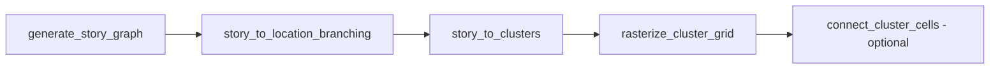

# Story graph (progression pipeline)

Technical reference for the **story graph** path in world generation: an abstract progression DAG that is laid out in space before richer narrative content attaches. For player-facing intent, see Marloth [`docs/game/features/gameplay/story-progression.md`](../../marloth/docs/game/features/gameplay/story-progression.md) (sibling workspace folder **`marloth`**).

## Pipeline

| Stage | Role |
|-------|------|
| `generate_story_graph` | Builds a linear chain of nodes with `direct` (first link) and `unlocks` (later links) connection attributes. |
| `story_to_location_branching` | Rewires the chain into a branching DAG so keys are not adjacent to gates; forces backtracking in traversal order. |
| `story_to_clusters` | Places one grid cell per node and connects paths between spatial neighbors (or records portal pairs when space is exhausted). |
| `rasterize_cluster_grid` | Expands sparse cluster cells into room-sized hex footprints (`Block` layers via `winding_path_block`). |
| `connect_cluster_cells` | Optional corridors between scaled cluster centers (default off; matches Unreal `CONNECT_CLUSTERS`). |

Public composition API in margen: `generate_story_grid` / `generate_story_grid_with_config` (`crates/margen/src/structure/story/generate_story_grid.rs`). C ABI: `margen_generate_story_grid` in [`include/margen.h`](../include/margen.h).

Default story raster config: `radius=3`, `margin=1`, `headroom=3`, `connect_clusters=false`.

## Connection attributes

Defined in `crates/margen/src/story/types.rs` (`story_connection_attribute`):

- **`direct`** — nodes are spatial neighbors with no gating between them.
- **`unlocks`** — the source node holds the means to open progress toward the target (switch/key semantics downstream).

## Unreal reference behavior

In **unreal-marloth**, the story path is selected when `GENERATE_STORY=1` in DotEnv (defaults off). Entry point: `generateStoryWorldGrid` in `GenerationIntegration/Integration/GenerateClusterWorldGrid.cpp`, called from `SimulationGeneration/Generation/GenerationIntegration.cpp`.

When story mode is active:

- Sector assignment is **one sector per story node** (derived from cell tags), not `partitionSectors` from path analysis.
- Goal/switch creation uses a **simplified path** from `unlocks` edges; full `generateGoals` is bypassed or commented out.

The default production path remains **prefab start + `windingPath`**, then analysis-derived sectors and full goal generation.

## Port status (margen)

| Piece | Status |
|-------|--------|
| `generate_story_graph`, `story_to_location_branching`, dependency querying | Ported (Rust Stage 0) |
| Core types (`WorldCell`, `CellGrid`, directions, `Sector`, …) | Ported (Rust Stage 1) |
| `sectors_to_dag` | Ported |
| `story_to_clusters`, `connect_cells_with_path` subset | Ported |
| `generate_story_grid` + C ABI | Ported |
| `Biome` / constant `GetBiome`, `Block` / `add_connected_block`, congruence | Ported |
| `rasterize_cluster_grid`, optional `connect_cluster_cells` | Ported |
| Spatial `BiomeDistribution` sampling | Not yet ported |

C++ reference implementation: git branch **`archive/cpp-port`**.

## Future extension points (design only)

- **Node / edge metadata** for authored beats (dialogue hooks, objectives, spawn tables) without changing the DAG shape.
- **Alternate `generate_story_graph` inputs** beyond linear node count (branching story specs, authored graphs).
- **Integrator binding** in marloth: map `SectorLocationMap` and switch entries to Godot scenes and gameplay events.

Algorithms stay in **margen**; Godot presentation and narrative scripting stay in **marloth**.
