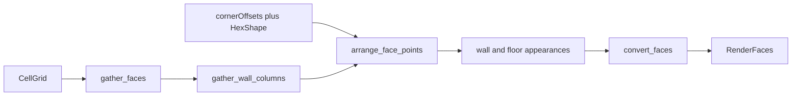

# Surfacing face IR

Technical reference for Unreal **GenerationSurfacing**’s engine-agnostic face pipeline, ported as `margen_generation_surfacing`.

Stops at exportable **`RenderFace`** datasets. Mesh apply (`applySurfacing` / DynamicMesh), Integration facade, and Population stay out of this crate. **Face / world-faces C ABI** is exported from `margen_ffi` (`margen_generate_world_faces`).

## Pipeline

| Step | Role |
|------|------|
| `gather_faces` | Visible sides of solid, non-custom-mesh cells (8 side directions). |
| `gather_wall_columns` | Vertical spans of wall faces for material tiling. |
| `arrange_face_points` | Resolve unit-space hex corners → polygon points per face. |
| Appearances | Tag-based material pick + UVs (`Face.Wall` / `Floor` / `Ceiling`). |
| `convert_faces` | Structure + appearance → `RenderFace` list. |

Facade: `generate_render_faces` in `crates/margen_generation_surfacing`.

## Empty-offset contract

Empty `SharedCellVertexOffsets` and `HexCellCornersMap` still produce valid prism faces via default HexShape corner resolve. Organic `refineWorldGrid` (slopes / wall shift) remains deferred; it would fill those maps later.

## Prerequisites (in `margen_generation`)

- `SharedCellCorner` / shared vertex offset map helpers
- `HexCellCorners` (14 corners) + `resolve_relative_cell_corner_coordinates`
- Plain `MaterialPlaceable` on `Biome.materials`

## Deferred

| Piece | Notes |
|-------|-------|
| `refineWorldGrid` | Surfacing inputs for organic corners |
| Integration facade | `generate_sector_geometry` orchestration crate |
| Mesh apply / Modeling | Engine hosts (margen-godot, marloth) |
| Population | Separate layer |

Unreal reference: `GenerationSurfacing/Faces`, `Preparation/{Structure,Materials}`, `Integration/ConvertFaces`; corner resolve in `Generation/Core/{HexShape,SharedCellVertices}`.
